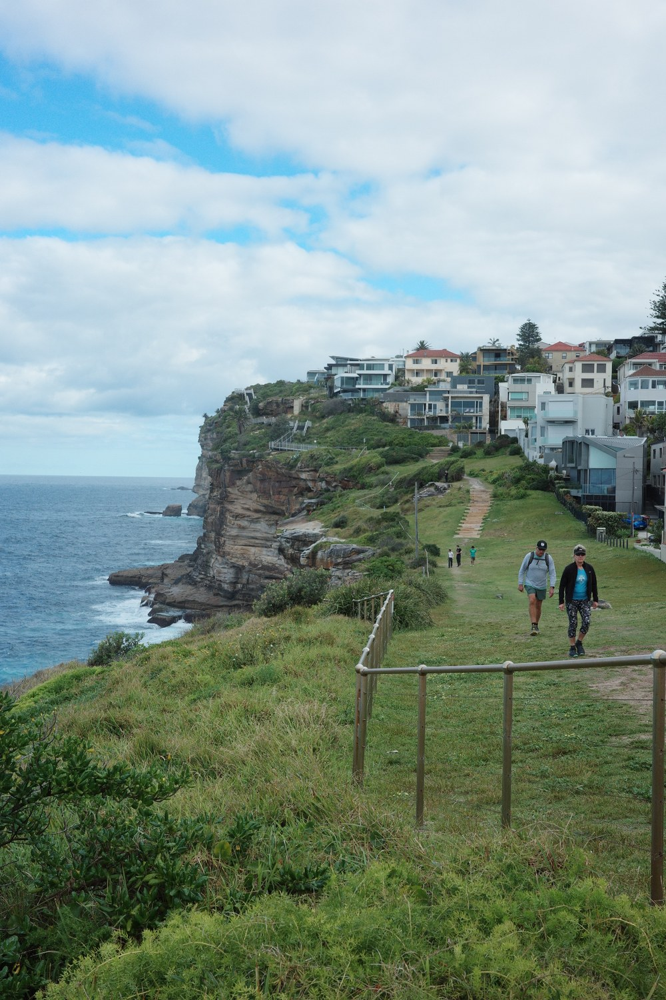
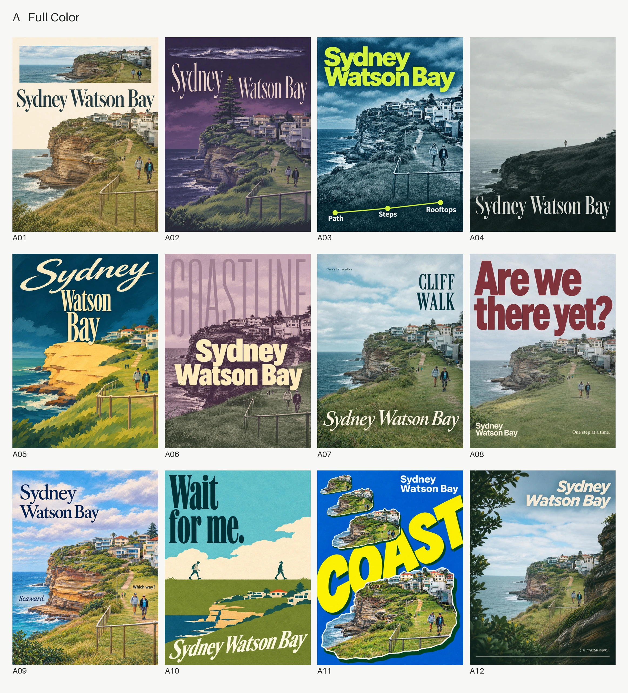
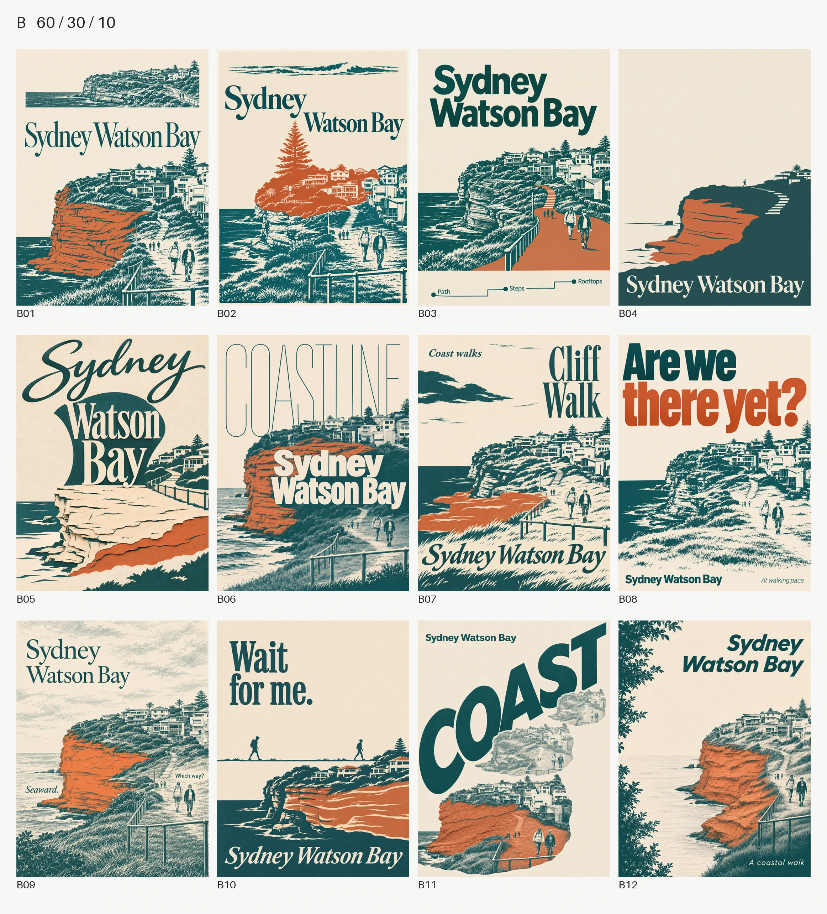
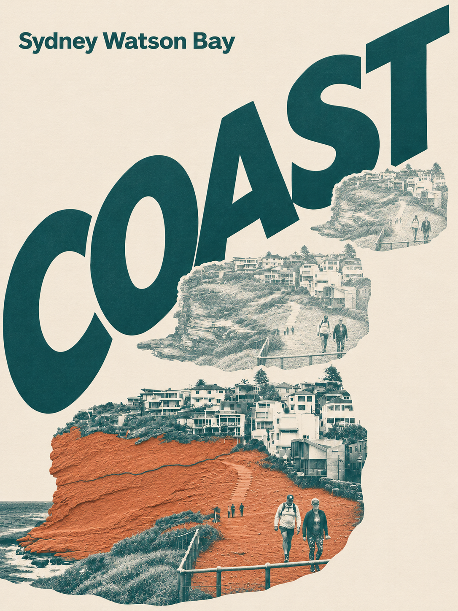

# 风景册 · 风景海报 Skill

风景册把四季风景、街景和旅行随拍做成海报。上传一张原图即可，有必要保留的文字可以一并提供。先看**多彩、三色两张选款概览**。每张都有 12 种构图。选中一个编号，风景册再用原图生成那一款高清海报，并附上实际使用的提示词与设计配方。画面可以有人，例如沙洲尽头的两个背影，就能让人感到天地有多开阔。

## 选款示例

### 1. 上传一张风景照

> 把这张海岸照片做成海报。请保留标题「Sydney Watson Bay」，其他文案你来配。

[](examples/sydney-watson-bay/coastal-photo.jpg)

### 2. 从两张概览里选一格

第一轮会收到 **24 个候选方案**。下面每张图都有 4 列 × 3 行，按行从左到右编号。可以横向比较两种配色里的同一款构图，也可以直接挑最喜欢的一格。点开图片可以放大看字和细节。

| **A · 多彩（A01–A12）** | **B · 三色（B01–B12）** |
| --- | --- |
| [](examples/sydney-watson-bay/a-overview.webp) | [](examples/sydney-watson-bay/b-overview.webp) |
| 每款可以自由配色。海水、草坡、岩层和标题可以各自保留颜色。 | 这张海岸照选了贝壳白、深海青、陶土橙。约六成主色定基调、三成辅色撑结构、一成点缀色引导视线。换一张照片会重新取色。 |

### 3. 回复「我选三色第 11 款」，拿到高清海报

> 我选三色第 11 款，帮我把这张做成高清海报。

三色总览**第三行、第三列**就是 **B11「斜轴上的分身」**。风景册按选中的小样确定构图、字位和配色，再回到上传的原照取细节，只制作这一款。

[](examples/sydney-watson-bay/b11-coast.png)

原照里的岬角沿着 **COAST** 的斜线由近至远出现三次。只有最近的一层岩壁和步道用了陶土橙，两处远景逐渐变淡。[打开高清 PNG（1086 × 1448）](examples/sydney-watson-bay/b11-coast.png) · [查看 B11 实际使用的生成与校色提示词](examples/sydney-watson-bay/b11-prompt.md)

## 风景册怎样生成海报

风景册先看原图哪里空、哪里密，找出能认出现场的轮廓和细节，再把同一份必要文案分别放入 12 种构图。比如两栋楼可以框住落日，标题就靠楼体内缘排；换成窄谷，标题可以收成两行，让出中间的谷底。只传照片时，也可以根据可见的景物拟一个短标题。

每格的生成配方分六项。**Mode** 定表现方式，**Ink** 分配颜色，**Layout** 定裁切和构图，**Type** 定字体与字位，**Process** 说明各层怎样处理，**Originality** 记录这张照片独有的设计决定。用户选好后，风景册结合原图、入选格预览和这份配方生成高清成片，并核对必要文案与构图关系。

如果一开始就有明确选择，可以直接说「用三色第 11 款出高清」。也可以请风景册代选并直接出片。

## 构图图谱怎么读


图谱收录 **12 种构图、24 张抽象排字样例**。细框标字位，深浅色面表示主体和空间。切换同一款的两个题材，可以看到哪些关系要保留，哪些形状、文字和颜色可以换。下载 HTML 后用浏览器打开即可离线查看。[交互构图图谱](references/atlas.html) · [12 款构图选择表](references/layout-selection.md)

| 看图时问什么 | 设计时怎样用 |
| --- | --- |
| **Visual System · 先看到什么？** | 确定第一眼和第二眼的落点。例如先读地名，再沿轮廓看到水边的小人。 |
| **Typography · 字怎么排？** | 定主次、字形、字重和字宽。窄长标题可以伸入狭长留白，说明文字要落在足够平静的区域。 |
| **Color · 颜色各负责什么？** | A 系为每款自由定色，B 系把照片、纸面和文字一起算入约 60／30／10 的面积分配。用明暗保证缩小后读得清，用冷暖或饱和度把目光引到细节。 |
| **Layout · 各层在哪里？** | 标出位置、占幅与遮挡顺序。例如先排标题，再用一段前景轮廓轻压字脚。 |
| **Style · 哪一层要做处理？** | 把描边、颗粒或复制只用在需要的层。原图抠出后缩小、旋转，仍是同一份原素材。 |

点开一张卡的“制作标注”，可以逐层区分**自有原图、可编辑文字、直接绘制的图形和按需生成的素材**。每个标记都说明这一层放什么、怎样处理、缺少素材时怎样替换。它们描述的是复用这款海报的做法。

### 树影风景拼贴

12 种构图提供选款和排版参考。**树影风景拼贴**另有可直接运行的专用脚本，适合 6–12 张能裁进枝间窗格的风景照片。枝条决定照片之间的分界，右上主窗控制在约四分之一画面以内，饱和橙红留给小窗。默认输出无字的 `1206 × 2310` 竖版 PNG。[树影风景拼贴说明](styles/tree-scape-collage/SKILL.md)

## 安装

在**支持 Agent Skills、能访问 GitHub 并写入技能目录**的 Agent 里，复制下面这句话即可发起安装。仓库根目录就是完整的 Skill，安装名为 `fangqiu-poster`（项目原名“访秋海报”）。[Agent Skills 格式说明](https://agentskills.io/home)

```text
请帮我安装这个 Skill（https://github.com/panggungunvibe/fangqiu-poster）。将仓库根目录的完整技能安装为 fangqiu-poster。
```

普通风景海报需要 Agent 有能接收参考图的生图工具；安装本 Skill 提供的是图谱与制作方法。树影拼贴走本地脚本，需要 Python、Pillow 和 NumPy，可以让 Agent 按仓库的 `requirements.txt` 安装依赖。

<details>
<summary>在本地 Codex 中手动安装</summary>

```bash
git clone https://github.com/panggungunvibe/fangqiu-poster.git ~/.codex/skills/fangqiu-poster
python3 -m pip install -r ~/.codex/skills/fangqiu-poster/requirements.txt
```

如果自定义了 `CODEX_HOME`，将上面的 `~/.codex` 换成实际目录。安装后重新打开 Codex，让它加载新 Skill。

</details>

## 使用

上传素材后，可以直接描述想保留的内容。

> 用风景册把这张照片做成竖版海报，标题是《周末散步》。请保留街口的招牌。

看完两张概览图，在同一对话里回复你选的编号。

> 我选三色第 11 款，按这一格做高清海报。

有一组照片时，也可以指定拼贴风格。

> 用风景册的树影风景拼贴，把这 8 张旅行照片做成一张无字海报。

## 扩展与许可

每种专用风格放在 `styles/<style-name>/`，记录适用素材、制作入口和验收方法，再把选用条件登记到项目入口。拼贴脚本在本地处理照片。[项目入口](SKILL.md) · [MIT 许可证](LICENSE)
