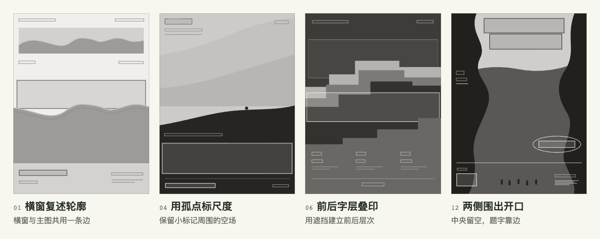

# 风景册 · 风景海报 Skill

把四季风景、城市街景和旅行随拍做成海报。给它一张图和一句标题，它会先看照片哪里开阔、哪里细节密、哪条轮廓值得保留，再决定字放在哪里。给它一组图，它会逐张看过，再决定用主图配小图、分格还是拼贴。画面里可以有人，比如沙洲尽头的两个背影就能让人感受到空间有多大。这个项目主要处理的是环境构图。

## 从一张照片到一张海报

1. **读图。** 先按实际画幅看明暗、疏密、边界和留白，标出需要完整保留的文字或轮廓。“没有明显主体”和“整幅都很密”也是有效判断。比如枝叶铺满整张照片时，可以保留原图，在画外加一条标题栏。
2. **选构图。** 用图中看得见的关系对照 12 种构图。假如左右两栋楼围出一片落日，就可以选“两侧围出开口”。换成两侧山壁间的亮谷，只要开口和边缘的字位仍在，同款依然适用。
3. **拿真实标题试排。** 把用户给的字放进目标画幅。短地名可以靠楼体内缘排一行；标题变长时，先试换行。若挡住落日，或裁成竖幅后开口已经消失，就换字位或换构图。
4. **合成并看成片。** 按方案组合原图、文字和图形，用蒙版控制前后遮挡。缩到手机预览大小，确认先看到的仍是预期的景或字，原图里重要的细节也读得清。

## 构图图谱怎么读



图谱收录 **12 种构图、24 张抽象排字样例**。细框标字位，深浅色面表示主体和空间。切换同一款的两个题材，可以看到哪些关系要保留，哪些形状、文字和颜色可以换。下载 HTML 后用浏览器打开即可离线查看。[交互构图图谱](references/atlas.html) · [12 款构图选择表](references/layout-selection.md)

| 看图时问什么 | 设计时怎样用 |
| --- | --- |
| **Visual System · 先看到什么？** | 确定第一眼和第二眼的落点。例如先读地名，再沿轮廓看到水边的小人。 |
| **Typography · 字怎么排？** | 定主次、字形、字重和字宽。窄长标题可以伸入狭长留白，说明文字要落在足够平静的区域。 |
| **Color · 颜色各负责什么？** | 分开底色、主字色和强调色。小面积的橙红也很抢眼，可以只留给一个细节。 |
| **Layout · 各层在哪里？** | 标出位置、占幅与遮挡顺序。例如先排标题，再用一段前景轮廓轻压字脚。 |
| **Style · 哪一层要做处理？** | 把描边、颗粒或复制只用在需要的层。原图抠出后缩小、旋转，仍是同一份原素材。 |

点开一张卡的“制作标注”，可以逐层区分**自有原图、可编辑文字、直接绘制的图形和按需生成的素材**。每个标记都说明这一层放什么、怎样处理、缺少素材时怎样替换。它们描述的是复用这款海报的做法。

### 树影风景拼贴

12 种构图提供选款和排版参考。**树影风景拼贴**另有可直接运行的专用脚本，适合 6–12 张能裁进枝间窗格的风景照片。枝条决定照片之间的分界，右上主窗控制在约四分之一画面以内，饱和橙红留给小窗。默认输出无字的 `1206 × 2310` 竖版 PNG。[树影风景拼贴说明](styles/tree-scape-collage/SKILL.md)

## 安装

在**支持 Agent Skills、能访问 GitHub 并写入技能目录**的 Agent 里，复制下面这句话即可发起安装。仓库根目录就是完整的 Skill，安装名为 `fangqiu-poster`（项目原名“访秋海报”）。[Agent Skills 格式说明](https://agentskills.io/home)

```text
请帮我安装这个 Skill（https://github.com/panggungunvibe/fangqiu-poster）。将仓库根目录的完整技能安装为 fangqiu-poster。
```

树影拼贴需要能执行 Python，并在运行脚本的环境里装有 Pillow 和 NumPy。可以让 Agent 按仓库的 `requirements.txt` 安装依赖。

<details>
<summary>在本地 Codex 中手动安装</summary>

```bash
git clone https://github.com/panggungunvibe/fangqiu-poster.git ~/.codex/skills/fangqiu-poster
python3 -m pip install -r ~/.codex/skills/fangqiu-poster/requirements.txt
```

如果自定义了 `CODEX_HOME`，将上面的 `~/.codex` 换成实际目录。安装后重新打开 Codex，让它加载新 Skill。

</details>

## 使用

上传素材后，可以直接描述想要的海报。

> 用风景册把这张照片做成竖版海报，标题是《周末散步》。请保留街口的招牌，其他由你按图选款。

有一组照片时，也可以指定拼贴风格。

> 用风景册的树影风景拼贴，把这 8 张旅行照片做成一张无字海报。

## 扩展与许可

每种专用风格放在 `styles/<style-name>/`，记录适用素材、制作入口和验收方法，再把选用条件登记到项目入口。拼贴脚本在本地处理照片。[项目入口](SKILL.md) · [MIT 许可证](LICENSE)
